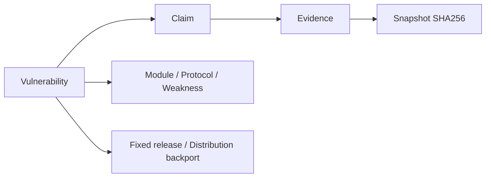

# Knowledge taxonomy

- AffectedCondition: 46
- Claim: 3341
- Component: 23
- ConfigurationDirective: 2
- DeploymentArchitecture: 1
- DistributionPackage: 166
- Evidence: 842
- Impact: 4
- LearningObjective: 5
- Mitigation: 1
- Module: 22
- Patch: 1
- Product: 9
- Protocol: 13
- Reference: 53
- Relationship: 734
- SecurityControl: 3
- Severity: 234
- Version: 28
- VersionRange: 51
- Vulnerability: 46
- Weakness: 24

