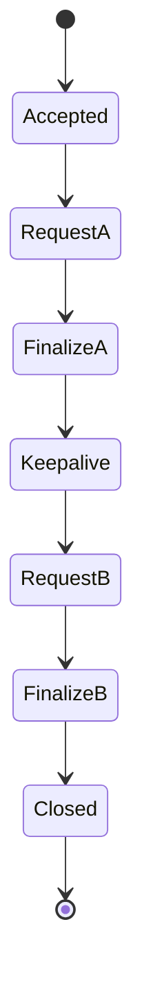

# Connection và HTTP request: hai vòng đời

Connection giữ ngữ cảnh socket và các sự kiện đọc/ghi; HTTP request có cấu trúc và quy trình finalization riêng.

## Mục tiêu đo được

- Vẽ hai request tuần tự trên một HTTP/1.1 keepalive connection.
- Xác định vì sao finalize request không luôn đồng nghĩa đóng socket.

Kiến thức tiên quyết: [[COMPONENT-EVENT-DRIVEN|Event loop và non-blocking I/O]].

## Hai đối tượng cần phân biệt

Connection biểu diễn trao đổi ở mức kết nối; request là một công việc HTTP với parsing, phase processing và response. Trong keepalive HTTP/1.1, một connection có thể phục vụ nhiều request kế tiếp. Phần HTTP trong development guide mô tả creation/finalization của request riêng với connection. [[CLAIM-3069E62B9E341B143D78FB42|nhận định nguồn: CLAIM:3069E62B9E341B143D78FB42]] Bài này không áp mô hình một-request-tại-một-thời-điểm cho multiplexing HTTP/2 hoặc HTTP/3.

_Diễn giải biên soạn; source support PARTIAL, AI self-review_: [[CLAIM-B572CC36FAA4E3A3A357E4F6|Claim theo section]].

## Cơ chế hoạt động

Sau accept, worker chờ dữ liệu và tạo ngữ cảnh HTTP phù hợp. Parser tích lũy request line/headers, các phase chọn và thực hiện handler, rồi output filter chuyển response qua chuỗi buffer. Finalization cần xét công việc chưa kết thúc; subrequest hoặc buffered output khiến 'handler trả về' khác với 'mọi tài nguyên đã được giải phóng'. Sau hoàn tất, connection có thể về trạng thái keepalive hoặc đóng theo quyết định tương ứng.

_Diễn giải biên soạn; source support PARTIAL, AI self-review_: [[CLAIM-D67C24E1A6DF436B5F62F0AF|Claim theo section]].

## Ownership và security boundary

Một dữ liệu có lifetime request không được giữ như thể nó tồn tại suốt connection. Ngược lại, hủy request không tự là quyền hủy dữ liệu chia sẻ còn được request khác dùng. Diễn giải invariant: mỗi callback cần biết nó gắn với connection hay request nào, và điều kiện để context đó còn sống. Boundary tin cậy xuất hiện lúc diễn giải dữ liệu client và lựa chọn policy, không phải cứ tạo một struct là tạo isolation.

_Diễn giải biên soạn; source support PARTIAL, AI self-review_: [[CLAIM-1AFA403D320F75514E1C207C|Claim theo section]].

## Tradeoff, điều khiển và giới hạn

Keepalive giảm chi phí tạo kết nối, nhưng giữ thêm state và cần timeout/ngân sách connection. Streaming giảm buffering toàn bộ nhưng yêu cầu quản lý backpressure và partial output. Không suy từ chữ 'buffer' trong advisory rằng lỗi ở memory pool: chỉ mô tả nguồn hoặc review mã mới xác định subsystem.

_Diễn giải biên soạn; source support PARTIAL, AI self-review_: [[CLAIM-35E487EF59FD2E0491D9A31A|Claim theo section]].

## Ví dụ giấy và ngộ nhận

Vẽ socket S chứa request A rồi B. A kết thúc, request pool A hết lifetime, nhưng S vẫn sống để nhận B. Đánh dấu dữ liệu nào phải sao chép hoặc tái tạo nếu B cần dùng; không mặc định con trỏ cũ hợp lệ. Đây là bài reasoning ownership, không là đầu vào tái hiện lỗi.

Câu hỏi mở: giao thức, module lọc và upstream configuration cụ thể ảnh hưởng finalization như thế nào? Cần phiên bản và mã nguồn tương ứng trước khẳng định chi tiết thứ tự cleanup.

_Diễn giải biên soạn; source support PARTIAL, AI self-review_: [[CLAIM-C63DFA01D161CC11AB99363B|Claim theo section]].

## Sơ đồ cơ chế

Sơ đồ là diễn giải sư phạm trong phạm vi bài; không phải sơ đồ mã nguồn đầy đủ.

## Tự đánh giá

1. Một connection đã xử lý A và đang chờ B có thể còn sống khi pool A đã hủy không?
2. Khi handler trả về, có được kết luận output đã gửi hết không?

## Đáp án và giải thích

1. Có trong mô hình keepalive của bài; request lifetime hẹp hơn connection lifetime.
2. Không; phải xét buffered output và cơ chế finalization. Tham chiếu [[CLAIM-3069E62B9E341B143D78FB42|nhận định nguồn: CLAIM:3069E62B9E341B143D78FB42]] và #http_request_finalization. Mỗi câu 2 điểm khi nêu được đúng đối tượng và trạng thái.

## Liên hệ và bước tiếp theo

[[COMPONENT-EVENT-DRIVEN|Event loop và non-blocking I/O]], [[COMPONENT-MEMORY-POOL|Memory pool: ownership, lifetime và cleanup]], [[LEARNING-PATH-01|NGINX Architecture, TLS Security & Patch Verification]]

## Quan hệ có định kiểu

- `DEPENDS_ON` → [[COMPONENT-EVENT-DRIVEN|Event loop và non-blocking I/O]] — Connection tiến triển qua các sự kiện I/O và timer; không phải proof về một CVE. **INTERPRETATION / NOT_REVIEWED**.
- `ASSESSED_BY` → [[LEARNING-PATH-01|NGINX Architecture, TLS Security & Patch Verification]] — Capstone yêu cầu vận dụng cơ chế này; đáp án và rubric nằm trong learning path. **PEDAGOGICAL / NOT_REVIEWED**.
- `PRECEDES` → [[COMPONENT-MEMORY-POOL|Memory pool: ownership, lifetime và cleanup]] — Thứ tự pilot chuyển từ cơ chế vừa học sang mục tiêu kế tiếp; là quyết định sư phạm, chưa learner-tested. **PEDAGOGICAL / NOT_REVIEWED**.
- `REQUIRES_KNOWLEDGE_OF` → [[COMPONENT-EVENT-DRIVEN|Event loop và non-blocking I/O]] — Cần Event loop và non-blocking I/O để giải thích mục tiêu: Vẽ hai request tuần tự trên một HTTP/1.1 keepalive connection. **PEDAGOGICAL / NOT_REVIEWED**.

## Truy vết nhận định

Mỗi link mở đúng Claim ID và giá trị; nhãn legacy không phải semantic approval.

| Claim / giá trị | Authority | Hiệu lực | Source support / review | Evidence locator |
| --- | --- | --- | --- | --- |
| [[CLAIM-3069E62B9E341B143D78FB42\|COMPONENT:CONNECTION-LIFECYCLE: pilot_source_statement]] — "Connection giữ ngữ cảnh socket và các sự kiện đọc/ghi; HTTP request có cấu trúc và quy trình finalization riêng." | NGINX / F5 | CURRENT | SUPPORTED / AI_REVIEWED | #connection; #http_connection; #http_request; #http_request_finalization — [[EVIDENCE-73508A92036558C7B2D50317\|development: #connection; #http_connection; #http_request; #http_request_finalization]] |
| [[CLAIM-B572CC36FAA4E3A3A357E4F6\|COMPONENT:CONNECTION-LIFECYCLE: pilot_section:Hai đối tượng cần phân biệt]] — "## Hai đối tượng cần phân biệt\n\nConnection biểu diễn trao đổi ở mức kết nối; request là một công việc HTTP với parsing, phase processing và response. Trong keepalive HTTP/1.1, m… (mở Claim để đọc đủ) | NVKB AI curation | CURRENT | PARTIAL / AI_REVIEWED | #connection; #http_connection; #http_request; #http_request_finalization — [[EVIDENCE-73508A92036558C7B2D50317\|development: #connection; #http_connection; #http_request; #http_request_finalization]] |
| [[CLAIM-D67C24E1A6DF436B5F62F0AF\|COMPONENT:CONNECTION-LIFECYCLE: pilot_section:Cơ chế hoạt động]] — "## Cơ chế hoạt động\n\nSau accept, worker chờ dữ liệu và tạo ngữ cảnh HTTP phù hợp. Parser tích lũy request line/headers, các phase chọn và thực hiện handler, rồi output filter ch… (mở Claim để đọc đủ) | NVKB AI curation | CURRENT | PARTIAL / AI_REVIEWED | #connection; #http_connection; #http_request; #http_request_finalization — [[EVIDENCE-73508A92036558C7B2D50317\|development: #connection; #http_connection; #http_request; #http_request_finalization]] |
| [[CLAIM-1AFA403D320F75514E1C207C\|COMPONENT:CONNECTION-LIFECYCLE: pilot_section:Ownership và security boundary]] — "## Ownership và security boundary\n\nMột dữ liệu có lifetime request không được giữ như thể nó tồn tại suốt connection. Ngược lại, hủy request không tự là quyền hủy dữ liệu chia s… (mở Claim để đọc đủ) | NVKB AI curation | CURRENT | PARTIAL / AI_REVIEWED | #connection; #http_connection; #http_request; #http_request_finalization — [[EVIDENCE-73508A92036558C7B2D50317\|development: #connection; #http_connection; #http_request; #http_request_finalization]] |
| [[CLAIM-35E487EF59FD2E0491D9A31A\|COMPONENT:CONNECTION-LIFECYCLE: pilot_section:Tradeoff, điều khiển và giới hạn]] — "## Tradeoff, điều khiển và giới hạn\n\nKeepalive giảm chi phí tạo kết nối, nhưng giữ thêm state và cần timeout/ngân sách connection. Streaming giảm buffering toàn bộ nhưng yêu cầu… (mở Claim để đọc đủ) | NVKB AI curation | CURRENT | PARTIAL / AI_REVIEWED | #connection; #http_connection; #http_request; #http_request_finalization — [[EVIDENCE-73508A92036558C7B2D50317\|development: #connection; #http_connection; #http_request; #http_request_finalization]] |
| [[CLAIM-C63DFA01D161CC11AB99363B\|COMPONENT:CONNECTION-LIFECYCLE: pilot_section:Ví dụ giấy và ngộ nhận]] — "## Ví dụ giấy và ngộ nhận\n\nVẽ socket S chứa request A rồi B. A kết thúc, request pool A hết lifetime, nhưng S vẫn sống để nhận B. Đánh dấu dữ liệu nào phải sao chép hoặc tái tạo… (mở Claim để đọc đủ) | NVKB AI curation | CURRENT | PARTIAL / AI_REVIEWED | #connection; #http_connection; #http_request; #http_request_finalization — [[EVIDENCE-73508A92036558C7B2D50317\|development: #connection; #http_connection; #http_request; #http_request_finalization]] |

## Phạm vi kiểm chứng

[[EVIDENCE-73508A92036558C7B2D50317|development: #connection; #http_connection; #http_request; #http_request_finalization]]

AI self-review of a scoped source statement and authored interpretations; human technical/pedagogical review and learner evaluation PENDING.

No deployment inspection or source-code root cause verification. Statements beyond cited mechanism are interpretations.

[[Learning-Library|Learning Library]] · [[Research-Library|Research Library]]

