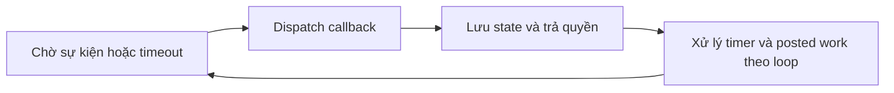

# Event loop và non-blocking I/O

Event loop NGINX xử lý thông báo I/O, timer và posted events; worker lặp vòng xử lý đến khi thoát.

## Mục tiêu đo được

- Phân biệt readiness với hoàn tất I/O qua một timeline.
- Giải thích tác động của callback blocking lên các kết nối cùng worker.

Kiến thức tiên quyết: [[COMPONENT-MASTER-PROCESS|Master, worker và graceful reload]].

## Readiness và tiến độ

Event-driven không có nghĩa mỗi connection có một thread riêng. Worker lưu trạng thái để tiếp tục xử lý khi có sự kiện phù hợp. Backend I/O báo socket có thể sẵn sàng; callback thử đọc/ghi, xử lý lượng dữ liệu đã có rồi trả quyền điều khiển khi cần chờ. Ready không bảo đảm toàn bộ message ứng dụng đã đến, cũng không bảo đảm mọi byte muốn ghi đã được gửi. [[CLAIM-D17E29368273C82888C95A90|nhận định nguồn: CLAIM:D17E29368273C82888C95A90]]

_Diễn giải biên soạn; source support PARTIAL, AI self-review_: [[CLAIM-1D1D846BA118D5F4878A92A0|Claim theo section]].

## Vòng đời callback

Development guide phân biệt I/O events, timer và posted events. Timer biểu diễn hạn chờ; posted event trì hoãn xử lý trong luồng event loop, không tự tạo thread. Mã callback phải duy trì vị trí đã xử lý và trạng thái chờ của đối tượng. Một response có thể cần nhiều lần callback trước khi hoàn tất. Khi kết nối đóng, các tham chiếu sự kiện liên quan phải tương thích với lifetime đối tượng.

_Diễn giải biên soạn; source support PARTIAL, AI self-review_: [[CLAIM-2CF6401DB3A7E756F86936E7|Claim theo section]].

## Ownership và invariant phòng vệ

Diễn giải từ cơ chế: callback chỉ được truy cập context còn sống và phải trả quyền cho vòng lặp trong thời gian phù hợp với thiết kế. Kernel readiness là thông tin về khả năng I/O, không phải phê duyệt dữ liệu từ peer. Parse và authorization vẫn là nhiệm vụ ở lớp tương ứng. Ngân sách tài nguyên cần xét tổng các kết nối trên worker, không chỉ từng request.

_Diễn giải biên soạn; source support PARTIAL, AI self-review_: [[CLAIM-91DFF79891134742C71BF8C2|Claim theo section]].

## Tradeoff và hiểu lầm

Non-blocking socket hạn chế thời gian chờ I/O trong callback, nhưng không làm mọi đoạn tính toán hoặc thư viện ngoài trở nên bất đồng bộ. Một tác vụ CPU dài hay lời gọi blocking có thể giữ worker bận, làm chậm các kết nối khác. Thread pool/offload chỉ áp dụng cho các đường được triển khai hỗ trợ, không tự động bao mọi module. Cấu trúc event-driven giảm nhu cầu thread-per-connection nhưng khiến state machine và cleanup cần được thiết kế rõ.

_Diễn giải biên soạn; source support PARTIAL, AI self-review_: [[CLAIM-3AACD36DD5D6FF55A2579CB8|Claim theo section]].

## Ví dụ đọc timeline

T0 socket ready; T1 callback đọc được phần đầu; T2 cần thêm dữ liệu và trả; T3 timer cho một request khác được xử lý; T4 socket ready lần nữa. Giải thích được T3 là đã hiểu lợi ích trả quyền cho event loop. Nếu callback T1 quay vòng chờ dữ liệu, đây là vi phạm mô hình của ví dụ, không cần chạy một chương trình gây treo để học.

Chưa đo scheduler fairness, latency hoặc backend cụ thể trong deployment. Thứ tự chi tiết cần đọc phiên bản mã nguồn tương ứng; sơ đồ dưới đây chỉ là chu kỳ khái niệm.

_Diễn giải biên soạn; source support PARTIAL, AI self-review_: [[CLAIM-9970C2D5D5603FB16C467573|Claim theo section]].

## Sơ đồ cơ chế

Sơ đồ là diễn giải sư phạm trong phạm vi bài; không phải sơ đồ mã nguồn đầy đủ.

## Tự đánh giá

1. Ready-read có đồng nghĩa HTTP request đầy đủ không?
2. Callback làm phép tính dài có được non-blocking socket tự động chuyển sang thread khác không?

## Đáp án và giải thích

1. Không; readiness chỉ cho biết có khả năng tiến triển I/O. Parser vẫn giữ trạng thái chờ phần còn thiếu.
2. Không; event loop không tự offload tính toán. Phải xem đường offload được hỗ trợ và scope của nó. [[CLAIM-D17E29368273C82888C95A90|nhận định nguồn: CLAIM:D17E29368273C82888C95A90]] cùng các section I/O/timer/posted events giải thích cơ chế. 0–2 điểm mỗi câu.

## Liên hệ và bước tiếp theo

[[COMPONENT-MASTER-PROCESS|Master, worker và graceful reload]], [[COMPONENT-CONNECTION-LIFECYCLE|Connection và HTTP request: hai vòng đời]], [[LEARNING-PATH-01|NGINX Architecture, TLS Security & Patch Verification]]

## Quan hệ có định kiểu

- `ASSESSED_BY` → [[LEARNING-PATH-01|NGINX Architecture, TLS Security & Patch Verification]] — Capstone yêu cầu vận dụng cơ chế này; đáp án và rubric nằm trong learning path. **PEDAGOGICAL / NOT_REVIEWED**.
- `REQUIRES_KNOWLEDGE_OF` → [[COMPONENT-MASTER-PROCESS|Master, worker và graceful reload]] — Cần Master, worker và graceful reload để giải thích mục tiêu: Phân biệt readiness với hoàn tất I/O qua một timeline. **PEDAGOGICAL / NOT_REVIEWED**.
- `PRECEDES` → [[COMPONENT-CONNECTION-LIFECYCLE|Connection và HTTP request: hai vòng đời]] — Thứ tự pilot chuyển từ cơ chế vừa học sang mục tiêu kế tiếp; là quyết định sư phạm, chưa learner-tested. **PEDAGOGICAL / NOT_REVIEWED**.

## Truy vết nhận định

Mỗi link mở đúng Claim ID và giá trị; nhãn legacy không phải semantic approval.

| Claim / giá trị | Authority | Hiệu lực | Source support / review | Evidence locator |
| --- | --- | --- | --- | --- |
| [[CLAIM-D17E29368273C82888C95A90\|COMPONENT:EVENT-DRIVEN: pilot_source_statement]] — "Event loop NGINX xử lý thông báo I/O, timer và posted events; worker lặp vòng xử lý đến khi thoát." | NGINX / F5 | CURRENT | SUPPORTED / AI_REVIEWED | #event_loop; #i_o_events; #timer_events; #posted_events — [[EVIDENCE-D35DA452C2D1E165CD488B2C\|development: #event_loop; #i_o_events; #timer_events; #posted_events]] |
| [[CLAIM-1D1D846BA118D5F4878A92A0\|COMPONENT:EVENT-DRIVEN: pilot_section:Readiness và tiến độ]] — "## Readiness và tiến độ\n\nEvent-driven không có nghĩa mỗi connection có một thread riêng. Worker lưu trạng thái để tiếp tục xử lý khi có sự kiện phù hợp. Backend I/O báo socket c… (mở Claim để đọc đủ) | NVKB AI curation | CURRENT | PARTIAL / AI_REVIEWED | #event_loop; #i_o_events; #timer_events; #posted_events — [[EVIDENCE-D35DA452C2D1E165CD488B2C\|development: #event_loop; #i_o_events; #timer_events; #posted_events]] |
| [[CLAIM-2CF6401DB3A7E756F86936E7\|COMPONENT:EVENT-DRIVEN: pilot_section:Vòng đời callback]] — "## Vòng đời callback\n\nDevelopment guide phân biệt I/O events, timer và posted events. Timer biểu diễn hạn chờ; posted event trì hoãn xử lý trong luồng event loop, không tự tạo t… (mở Claim để đọc đủ) | NVKB AI curation | CURRENT | PARTIAL / AI_REVIEWED | #event_loop; #i_o_events; #timer_events; #posted_events — [[EVIDENCE-D35DA452C2D1E165CD488B2C\|development: #event_loop; #i_o_events; #timer_events; #posted_events]] |
| [[CLAIM-91DFF79891134742C71BF8C2\|COMPONENT:EVENT-DRIVEN: pilot_section:Ownership và invariant phòng vệ]] — "## Ownership và invariant phòng vệ\n\nDiễn giải từ cơ chế: callback chỉ được truy cập context còn sống và phải trả quyền cho vòng lặp trong thời gian phù hợp với thiết kế. Kernel … (mở Claim để đọc đủ) | NVKB AI curation | CURRENT | PARTIAL / AI_REVIEWED | #event_loop; #i_o_events; #timer_events; #posted_events — [[EVIDENCE-D35DA452C2D1E165CD488B2C\|development: #event_loop; #i_o_events; #timer_events; #posted_events]] |
| [[CLAIM-3AACD36DD5D6FF55A2579CB8\|COMPONENT:EVENT-DRIVEN: pilot_section:Tradeoff và hiểu lầm]] — "## Tradeoff và hiểu lầm\n\nNon-blocking socket hạn chế thời gian chờ I/O trong callback, nhưng không làm mọi đoạn tính toán hoặc thư viện ngoài trở nên bất đồng bộ. Một tác vụ CPU… (mở Claim để đọc đủ) | NVKB AI curation | CURRENT | PARTIAL / AI_REVIEWED | #event_loop; #i_o_events; #timer_events; #posted_events — [[EVIDENCE-D35DA452C2D1E165CD488B2C\|development: #event_loop; #i_o_events; #timer_events; #posted_events]] |
| [[CLAIM-9970C2D5D5603FB16C467573\|COMPONENT:EVENT-DRIVEN: pilot_section:Ví dụ đọc timeline]] — "## Ví dụ đọc timeline\n\nT0 socket ready; T1 callback đọc được phần đầu; T2 cần thêm dữ liệu và trả; T3 timer cho một request khác được xử lý; T4 socket ready lần nữa. Giải thích … (mở Claim để đọc đủ) | NVKB AI curation | CURRENT | PARTIAL / AI_REVIEWED | #event_loop; #i_o_events; #timer_events; #posted_events — [[EVIDENCE-D35DA452C2D1E165CD488B2C\|development: #event_loop; #i_o_events; #timer_events; #posted_events]] |

## Phạm vi kiểm chứng

[[EVIDENCE-D35DA452C2D1E165CD488B2C|development: #event_loop; #i_o_events; #timer_events; #posted_events]]

AI self-review of a scoped source statement and authored interpretations; human technical/pedagogical review and learner evaluation PENDING.

No deployment inspection or source-code root cause verification. Statements beyond cited mechanism are interpretations.

[[Learning-Library|Learning Library]] · [[Research-Library|Research Library]]

