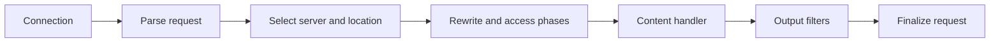

# HTTP request lifecycle

Vòng đời parse, chọn cấu hình, xử lý phase và hoàn tất response.

## Mục tiêu đo được

- Giải thích HTTP request lifecycle bằng cơ chế và ranh giới tin cậy.
- Phân biệt dữ kiện từ nguồn với nhận định suy luận; truy vết bằng evidence.

## Định nghĩa

Vòng đời parse, chọn cấu hình, xử lý phase và hoàn tất response.

## Cơ chế hoạt động bình thường

Request đi qua các phase như rewrite/access/content; output filter xử lý header/body trước khi gửi. Finalization điều phối tài nguyên và subrequest.

## Vị trí trong kiến trúc

Chuyển từ dữ liệu chưa tin cậy sang cấu hình, handler và response.

## Security boundary

Chuyển từ dữ liệu chưa tin cậy sang cấu hình, handler và response.

## Giả định an toàn

Trạng thái request và số tham chiếu phải nhất quán qua redirect/subrequest.

## Nhóm lỗi liên quan

Parsing inconsistency; use-after-free.

## Tác động khi giả định bị vi phạm

Định tuyến hoặc xử lý response sai.

## Nguyên tắc phòng vệ

Review thứ tự phase, giới hạn request và bảo đảm cleanup đúng vòng đời.

## Sơ đồ cơ chế

Sơ đồ là diễn giải sư phạm trong phạm vi bài; không phải sơ đồ mã nguồn đầy đủ.

## Truy vết nhận định

Mỗi link mở đúng Claim ID và giá trị; nhãn legacy không phải semantic approval.

| Claim / giá trị | Authority | Hiệu lực | Source support / review | Evidence locator |
| --- | --- | --- | --- | --- |
| [[CLAIM-D612E04E75A792F14CC55756\|COMPONENT:HTTP-REQUEST-LIFECYCLE: definition]] — "Vòng đời parse, chọn cấu hình, xử lý phase và hoàn tất response." | NGINX / F5 | CURRENT | NOT_REVIEWED / NOT_REVIEWED | EVIDENCE:DFBB5BD88F7FC640669D3012: HTTP; topic=COMPONENT:HTTP-REQUEST-LIFECYCLE — [[EVIDENCE-DFBB5BD88F7FC640669D3012\|Development guide]] |
| [[CLAIM-B5B5E71587FC1DDEA7FCC9E2\|COMPONENT:HTTP-REQUEST-LIFECYCLE: normal_behavior]] — "Request đi qua các phase như rewrite/access/content; output filter xử lý header/body trước khi gửi. Finalization điều phối tài nguyên và subrequest." | NGINX / F5 | CURRENT | NOT_REVIEWED / NOT_REVIEWED | EVIDENCE:DFBB5BD88F7FC640669D3012: HTTP; topic=COMPONENT:HTTP-REQUEST-LIFECYCLE — [[EVIDENCE-DFBB5BD88F7FC640669D3012\|Development guide]] |
| [[CLAIM-949797526F089C1F8563287E\|COMPONENT:HTTP-REQUEST-LIFECYCLE: architecture_position]] — "Chuyển từ dữ liệu chưa tin cậy sang cấu hình, handler và response." | NGINX / F5 | CURRENT | NOT_REVIEWED / NOT_REVIEWED | EVIDENCE:DFBB5BD88F7FC640669D3012: HTTP; topic=COMPONENT:HTTP-REQUEST-LIFECYCLE — [[EVIDENCE-DFBB5BD88F7FC640669D3012\|Development guide]] |
| [[CLAIM-A01A7289CABD987B4B99167B\|COMPONENT:HTTP-REQUEST-LIFECYCLE: security_boundary]] — "Chuyển từ dữ liệu chưa tin cậy sang cấu hình, handler và response." | NGINX / F5 | CURRENT | NOT_REVIEWED / NOT_REVIEWED | EVIDENCE:DFBB5BD88F7FC640669D3012: HTTP; topic=COMPONENT:HTTP-REQUEST-LIFECYCLE — [[EVIDENCE-DFBB5BD88F7FC640669D3012\|Development guide]] |
| [[CLAIM-9AAE9FD9E26073C267281D1F\|COMPONENT:HTTP-REQUEST-LIFECYCLE: safety_assumptions]] — "Trạng thái request và số tham chiếu phải nhất quán qua redirect/subrequest." | NGINX / F5 | CURRENT | NOT_REVIEWED / NOT_REVIEWED | EVIDENCE:DFBB5BD88F7FC640669D3012: HTTP; topic=COMPONENT:HTTP-REQUEST-LIFECYCLE — [[EVIDENCE-DFBB5BD88F7FC640669D3012\|Development guide]] |
| [[CLAIM-416993EDB0E8A85C41B698B4\|COMPONENT:HTTP-REQUEST-LIFECYCLE: related_failure_classes]] — "Parsing inconsistency; use-after-free." | NGINX / F5 | CURRENT | NOT_REVIEWED / NOT_REVIEWED | EVIDENCE:DFBB5BD88F7FC640669D3012: HTTP; topic=COMPONENT:HTTP-REQUEST-LIFECYCLE — [[EVIDENCE-DFBB5BD88F7FC640669D3012\|Development guide]] |
| [[CLAIM-D2B42248A48406040CF9970E\|COMPONENT:HTTP-REQUEST-LIFECYCLE: failure_impact]] — "Định tuyến hoặc xử lý response sai." | NGINX / F5 | CURRENT | NOT_REVIEWED / NOT_REVIEWED | EVIDENCE:DFBB5BD88F7FC640669D3012: HTTP; topic=COMPONENT:HTTP-REQUEST-LIFECYCLE — [[EVIDENCE-DFBB5BD88F7FC640669D3012\|Development guide]] |
| [[CLAIM-D04E27EBA5A98C45C8C8F815\|COMPONENT:HTTP-REQUEST-LIFECYCLE: defensive_principles]] — "Review thứ tự phase, giới hạn request và bảo đảm cleanup đúng vòng đời." | NGINX / F5 | CURRENT | NOT_REVIEWED / NOT_REVIEWED | EVIDENCE:DFBB5BD88F7FC640669D3012: HTTP; topic=COMPONENT:HTTP-REQUEST-LIFECYCLE — [[EVIDENCE-DFBB5BD88F7FC640669D3012\|Development guide]] |

## Phạm vi kiểm chứng

[[EVIDENCE-DFBB5BD88F7FC640669D3012|Development guide]]

Bản biên soạn cần semantic review; nhãn legacy không chứng nhận factual accuracy.

[[Learning-Library|Learning Library]] · [[Research-Library|Research Library]]

