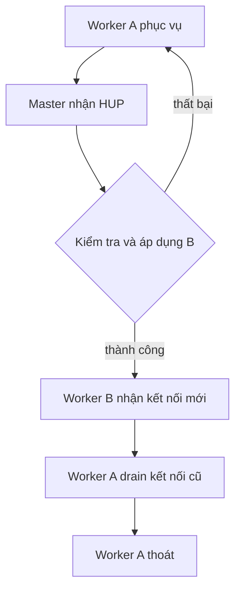

# Master, worker và graceful reload

Khi nhận HUP, master kiểm tra cấu hình mới và thử áp dụng; nếu thất bại nó quay về cấu hình cũ, nếu thành công nó khởi chạy worker mới và yêu cầu worker cũ kết thúc nhẹ nhàng.

## Mục tiêu đo được

- Sắp xếp đúng các bước reload và xác định nhánh thất bại.
- Giải thích vì sao hai thế hệ worker có thể cùng tồn tại.

Kiến thức tiên quyết: [[DEPLOYMENT-REVERSE-PROXY|Kiến trúc NGINX: tiến trình, kết nối và ranh giới tin cậy]].

## Định nghĩa và điều khiển

Master quản lý thế hệ cấu hình và worker, còn worker phục vụ kết nối. Graceful reload là chuyển cấu hình cho công việc mới trong khi cho phép công việc cũ kết thúc. Nó khác shutdown ngay và khác thay binary. Tài liệu điều khiển mô tả nhánh HUP kiểm cú pháp, thử mở tài nguyên cần thiết rồi mới khởi tạo worker mới. [[CLAIM-940DF1F8270B89D1A7C8136C|nhận định nguồn: CLAIM:940DF1F8270B89D1A7C8136C]]

_Diễn giải biên soạn; source support PARTIAL, AI self-review_: [[CLAIM-8E2D1D51931D236A2B26352B|Claim theo section]].

## State, trách nhiệm và invariant

Trước reload, thế hệ A nhận kết nối. Nếu cấu hình B không áp dụng được, A tiếp tục dùng cấu hình trước đó; không được coi việc gửi tín hiệu là chứng cứ B đã chạy. Nếu B thành công, worker mới nhận công việc và worker cũ đóng listening sockets, hoàn tất kết nối đang phục vụ rồi thoát. Do đó A và B có thể đồng thời tồn tại trong một khoảng chuyển tiếp.

Diễn giải phòng vệ: trạng thái cấu hình cần gắn với thế hệ tiến trình, không chỉ với file trên đĩa. Quyền của worker phụ thuộc cấu hình và môi trường khởi chạy; master/worker không tự là hai tenant cô lập. Invariant vận hành của bài là không xác nhận thay đổi đã hoàn tất chỉ từ việc file cấu hình mới tồn tại.

_Diễn giải biên soạn; source support PARTIAL, AI self-review_: [[CLAIM-734EF382279B214AD459BDA9|Claim theo section]].

## Lựa chọn kỹ thuật

Drain kết nối giúp giảm gián đoạn nhưng thời gian kết thúc phụ thuộc công việc còn sống và cấu hình shutdown. Reload cấu hình không thay binary của tiến trình đang chạy. Cập nhật package, chuyển cấu hình và chuyển binary là ba sự kiện cần kiểm chứng riêng. Worker cũ còn sống không tự chứng minh lỗi, nhưng có ý nghĩa khi một chính sách mới cần hiệu lực đồng nhất.

_Diễn giải biên soạn; source support PARTIAL, AI self-review_: [[CLAIM-64A2B524922D35EEBF31C76B|Claim theo section]].

## Ví dụ an toàn và giới hạn

Đọc một bảng sự kiện giả định: T0 cấu hình A; T1 yêu cầu reload; T2 phát hiện lỗi mở tài nguyên; T3 log tiếp tục A. Kết luận hợp lệ là B chưa được áp dụng. Với T2 thành công, chỉ ghi B đã khởi chạy; cần bằng chứng riêng về thời điểm worker A kết thúc. Không gửi tín hiệu cho máy thực trong bài này.

Ngộ nhận thường gặp là đồng nhất reload với restart hoặc cho rằng mọi kết nối chuyển tức thì sang policy mới. Guide mô tả quản lý tiến trình, không là bằng chứng cho thời hạn drain của một cấu hình bất kỳ. Câu hỏi mở: build, module và timeout của deployment có làm thay đổi kỳ vọng shutdown không?

_Diễn giải biên soạn; source support PARTIAL, AI self-review_: [[CLAIM-3CC064509827316E58DE1610|Claim theo section]].

## Sơ đồ cơ chế

Sơ đồ là diễn giải sư phạm trong phạm vi bài; không phải sơ đồ mã nguồn đầy đủ.

## Tự đánh giá

1. File B đúng cú pháp nhưng không mở được tài nguyên cần thiết: trạng thái nào còn phục vụ?
2. Tại sao inventory package mới chưa đủ chứng minh worker đã chạy binary mới?

## Đáp án và giải thích

1. Nhánh lỗi giữ cấu hình cũ theo [[CLAIM-940DF1F8270B89D1A7C8136C|nhận định nguồn: CLAIM:940DF1F8270B89D1A7C8136C]]; cần phân biệt kiểm cú pháp với áp dụng thành công.
2. Package trên đĩa và tiến trình đang chạy có lifecycle khác; reload cấu hình không chứng minh thay executable. Chấm 2 điểm mỗi câu nếu giải thích được cả kết luận và giới hạn.

## Liên hệ và bước tiếp theo

[[DEPLOYMENT-REVERSE-PROXY|Kiến trúc NGINX: tiến trình, kết nối và ranh giới tin cậy]], [[COMPONENT-EVENT-DRIVEN|Event loop và non-blocking I/O]], [[LEARNING-PATH-01|NGINX Architecture, TLS Security & Patch Verification]]

## Quan hệ có định kiểu

- `REQUIRES_KNOWLEDGE_OF` → [[DEPLOYMENT-REVERSE-PROXY|Kiến trúc NGINX: tiến trình, kết nối và ranh giới tin cậy]] — Cần Kiến trúc NGINX: tiến trình, kết nối và ranh giới tin cậy để giải thích mục tiêu: Sắp xếp đúng các bước reload và xác định nhánh thất bại. **PEDAGOGICAL / NOT_REVIEWED**.
- `PRECEDES` → [[COMPONENT-EVENT-DRIVEN|Event loop và non-blocking I/O]] — Thứ tự pilot chuyển từ cơ chế vừa học sang mục tiêu kế tiếp; là quyết định sư phạm, chưa learner-tested. **PEDAGOGICAL / NOT_REVIEWED**.
- `ASSESSED_BY` → [[LEARNING-PATH-01|NGINX Architecture, TLS Security & Patch Verification]] — Capstone yêu cầu vận dụng cơ chế này; đáp án và rubric nằm trong learning path. **PEDAGOGICAL / NOT_REVIEWED**.
- `PART_OF` → [[DEPLOYMENT-REVERSE-PROXY|Kiến trúc NGINX: tiến trình, kết nối và ranh giới tin cậy]] — Master điều phối lifecycle tiến trình trong deployment đa tiến trình được mô tả. **INTERPRETATION / NOT_REVIEWED**.

## Truy vết nhận định

Mỗi link mở đúng Claim ID và giá trị; nhãn legacy không phải semantic approval.

| Claim / giá trị | Authority | Hiệu lực | Source support / review | Evidence locator |
| --- | --- | --- | --- | --- |
| [[CLAIM-940DF1F8270B89D1A7C8136C\|COMPONENT:MASTER-PROCESS: pilot_source_statement]] — "Khi nhận HUP, master kiểm tra cấu hình mới và thử áp dụng; nếu thất bại nó quay về cấu hình cũ, nếu thành công nó khởi chạy worker mới và yêu cầu worker cũ kết thúc nhẹ nhàng." | NGINX / F5 | CURRENT | SUPPORTED / AI_REVIEWED | #reconfiguration — [[EVIDENCE-81E73A1E91C1D45517423D7A\|control: #reconfiguration]] |
| [[CLAIM-8E2D1D51931D236A2B26352B\|COMPONENT:MASTER-PROCESS: pilot_section:Định nghĩa và điều khiển]] — "## Định nghĩa và điều khiển\n\nMaster quản lý thế hệ cấu hình và worker, còn worker phục vụ kết nối. Graceful reload là chuyển cấu hình cho công việc mới trong khi cho phép công v… (mở Claim để đọc đủ) | NVKB AI curation | CURRENT | PARTIAL / AI_REVIEWED | #reconfiguration — [[EVIDENCE-81E73A1E91C1D45517423D7A\|control: #reconfiguration]] |
| [[CLAIM-734EF382279B214AD459BDA9\|COMPONENT:MASTER-PROCESS: pilot_section:State, trách nhiệm và invariant]] — "## State, trách nhiệm và invariant\n\nTrước reload, thế hệ A nhận kết nối. Nếu cấu hình B không áp dụng được, A tiếp tục dùng cấu hình trước đó; không được coi việc gửi tín hiệu l… (mở Claim để đọc đủ) | NVKB AI curation | CURRENT | PARTIAL / AI_REVIEWED | #reconfiguration — [[EVIDENCE-81E73A1E91C1D45517423D7A\|control: #reconfiguration]] |
| [[CLAIM-64A2B524922D35EEBF31C76B\|COMPONENT:MASTER-PROCESS: pilot_section:Lựa chọn kỹ thuật]] — "## Lựa chọn kỹ thuật\n\nDrain kết nối giúp giảm gián đoạn nhưng thời gian kết thúc phụ thuộc công việc còn sống và cấu hình shutdown. Reload cấu hình không thay binary của tiến tr… (mở Claim để đọc đủ) | NVKB AI curation | CURRENT | PARTIAL / AI_REVIEWED | #reconfiguration — [[EVIDENCE-81E73A1E91C1D45517423D7A\|control: #reconfiguration]] |
| [[CLAIM-3CC064509827316E58DE1610\|COMPONENT:MASTER-PROCESS: pilot_section:Ví dụ an toàn và giới hạn]] — "## Ví dụ an toàn và giới hạn\n\nĐọc một bảng sự kiện giả định: T0 cấu hình A; T1 yêu cầu reload; T2 phát hiện lỗi mở tài nguyên; T3 log tiếp tục A. Kết luận hợp lệ là B chưa được … (mở Claim để đọc đủ) | NVKB AI curation | CURRENT | PARTIAL / AI_REVIEWED | #reconfiguration — [[EVIDENCE-81E73A1E91C1D45517423D7A\|control: #reconfiguration]] |

## Phạm vi kiểm chứng

[[EVIDENCE-81E73A1E91C1D45517423D7A|control: #reconfiguration]]

AI self-review of a scoped source statement and authored interpretations; human technical/pedagogical review and learner evaluation PENDING.

No deployment inspection or source-code root cause verification. Statements beyond cited mechanism are interpretations.

[[Learning-Library|Learning Library]] · [[Research-Library|Research Library]]

