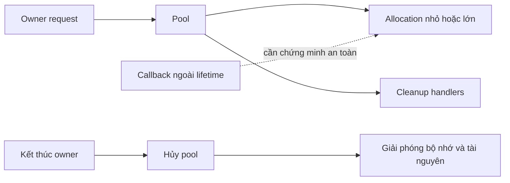

# Memory pool: ownership, lifetime và cleanup

Pool gom các allocation theo lifetime; khi pool bị hủy, bộ nhớ của pool được giải phóng và cleanup handlers đã đăng ký được gọi.

## Mục tiêu đo được

- Gán owner/lifetime cho ba tài nguyên trong request.
- Giải thích vì sao pool không tự bảo đảm mọi con trỏ còn hợp lệ.

Kiến thức tiên quyết: [[COMPONENT-CONNECTION-LIFECYCLE|Connection và HTTP request: hai vòng đời]].

## Đơn vị cấp phát và trách nhiệm

Pool là cơ chế quản lý bộ nhớ theo vòng đời đối tượng, thường gắn với request hoặc đối tượng NGINX khác. Allocation nhỏ lấy từ các block của pool; allocation lớn có thể dùng system allocator và được pool theo dõi để giải phóng. Cleanup callback giúp đóng tài nguyên ngoài heap như file descriptor. [[CLAIM-F2AFD88A14013931FC9455FE|nhận định nguồn: CLAIM:F2AFD88A14013931FC9455FE]]

_Diễn giải biên soạn; source support PARTIAL, AI self-review_: [[CLAIM-98F32D69C3CD47905B5885A2|Claim theo section]].

## Lifecycle có thể suy luận

Create owner → cấp phát state → dùng trong các callback hợp lệ → hoàn tất công việc → hủy pool và cleanup. Cleanup là thao tác cuối vòng đời đã định, không phải garbage collector theo dõi mọi tham chiếu bên ngoài. Pool không biết một module đã lưu địa chỉ ở đâu; việc phối hợp event/timer với lifetime vẫn thuộc trách nhiệm code sử dụng.

_Diễn giải biên soạn; source support PARTIAL, AI self-review_: [[CLAIM-1E0DCB10803E56ED48E6761E|Claim theo section]].

## Invariant và ranh giới

Diễn giải phòng vệ: mọi lần dùng một con trỏ phải xảy ra khi allocation và owner tương ứng còn sống. Một callback còn trong queue không tự kéo dài tuổi pool; nhà phát triển phải dùng cơ chế lifecycle thích hợp. Process heap và shared memory có phạm vi khác nhau. Hủy pool trong một worker không chứng minh state dùng chung giữa worker đã được xử lý đúng.

_Diễn giải biên soạn; source support PARTIAL, AI self-review_: [[CLAIM-1A26476243AB200244198FFA|Claim theo section]].

## Tradeoff và điều không được suy diễn

Thu hồi theo nhóm làm đơn giản cleanup và giảm chi phí quản lý nhiều allocation nhỏ, nhưng một object sống lâu có thể giữ bộ nhớ không còn cần đến cho đến khi owner kết thúc. Pool không ngăn buffer overrun, số học kích thước sai hay sử dụng context sai. Ngược lại, tên CWE memory safety không chứng minh một CVE cụ thể bắt nguồn từ pool. Cần review mã hoặc thông báo kỹ thuật rõ ràng cho kết luận đó.

_Diễn giải biên soạn; source support PARTIAL, AI self-review_: [[CLAIM-AC031036DF7A6A7C1E064CAD|Claim theo section]].

## Ví dụ an toàn

Lập bảng: request R sở hữu buffer B; connection C sống dài hơn R; callback K dự định đọc B. Hỏi điều kiện nào phải chứng minh trước khi K được gọi. Đáp án không cần viết mã lỗi: R/B phải còn sống, hoặc K dùng bản sao với owner phù hợp, hoặc K đã được hủy theo lifecycle. Cách nào đúng phụ thuộc API/module, nên không tự áp một cleanup order toàn cục.

Chưa có review độc lập implementation pool của từng phiên bản hay module bên thứ ba. Tài liệu cơ chế là nền cho reasoning; không là chứng nhận memory safety của một binary.

_Diễn giải biên soạn; source support PARTIAL, AI self-review_: [[CLAIM-559111D0D87379E5CEB0AC2B|Claim theo section]].

## Sơ đồ cơ chế

Sơ đồ là diễn giải sư phạm trong phạm vi bài; không phải sơ đồ mã nguồn đầy đủ.

## Tự đánh giá

1. Vì sao xóa một request không tự làm mọi tham chiếu bên ngoài trở nên an toàn?
2. Từ một advisory nói buffer issue, có thể kết luận lỗi nằm ở pool không?

## Đáp án và giải thích

1. Pool thu hồi allocation, không tự truy tìm mọi con trỏ do module giữ; phải phối hợp lifecycle callback.
2. Không; đó là bước suy luận thiếu nguồn về fault location. [[CLAIM-F2AFD88A14013931FC9455FE|nhận định nguồn: CLAIM:F2AFD88A14013931FC9455FE]] giải thích pool, không giải thích CVE bất kỳ. 0–2 điểm mỗi câu.

## Liên hệ và bước tiếp theo

[[COMPONENT-CONNECTION-LIFECYCLE|Connection và HTTP request: hai vòng đời]], [[PROTOCOL-TLS|TLS 1.3: handshake, identity và protected records]], [[LEARNING-PATH-01|NGINX Architecture, TLS Security & Patch Verification]]

## Quan hệ có định kiểu

- `REQUIRES_KNOWLEDGE_OF` → [[COMPONENT-CONNECTION-LIFECYCLE|Connection và HTTP request: hai vòng đời]] — Cần Connection và HTTP request: hai vòng đời để giải thích mục tiêu: Gán owner/lifetime cho ba tài nguyên trong request. **PEDAGOGICAL / NOT_REVIEWED**.
- `PARTICIPATES_IN` → [[COMPONENT-CONNECTION-LIFECYCLE|Connection và HTTP request: hai vòng đời]] — Pool gắn với lifetime đối tượng; scope của pool phải được phân biệt với socket. **INTERPRETATION / NOT_REVIEWED**.
- `ASSESSED_BY` → [[LEARNING-PATH-01|NGINX Architecture, TLS Security & Patch Verification]] — Capstone yêu cầu vận dụng cơ chế này; đáp án và rubric nằm trong learning path. **PEDAGOGICAL / NOT_REVIEWED**.
- `PRECEDES` → [[PROTOCOL-TLS|TLS 1.3: handshake, identity và protected records]] — Thứ tự pilot chuyển từ cơ chế vừa học sang mục tiêu kế tiếp; là quyết định sư phạm, chưa learner-tested. **PEDAGOGICAL / NOT_REVIEWED**.

## Truy vết nhận định

Mỗi link mở đúng Claim ID và giá trị; nhãn legacy không phải semantic approval.

| Claim / giá trị | Authority | Hiệu lực | Source support / review | Evidence locator |
| --- | --- | --- | --- | --- |
| [[CLAIM-F2AFD88A14013931FC9455FE\|COMPONENT:MEMORY-POOL: pilot_source_statement]] — "Pool gom các allocation theo lifetime; khi pool bị hủy, bộ nhớ của pool được giải phóng và cleanup handlers đã đăng ký được gọi." | NGINX / F5 | CURRENT | SUPPORTED / AI_REVIEWED | #pool; #shared_memory; #manual_memory_management — [[EVIDENCE-F3FDC08074102946B250B1B6\|development: #pool; #shared_memory; #manual_memory_management]] |
| [[CLAIM-98F32D69C3CD47905B5885A2\|COMPONENT:MEMORY-POOL: pilot_section:Đơn vị cấp phát và trách nhiệm]] — "## Đơn vị cấp phát và trách nhiệm\n\nPool là cơ chế quản lý bộ nhớ theo vòng đời đối tượng, thường gắn với request hoặc đối tượng NGINX khác. Allocation nhỏ lấy từ các block của p… (mở Claim để đọc đủ) | NVKB AI curation | CURRENT | PARTIAL / AI_REVIEWED | #pool; #shared_memory; #manual_memory_management — [[EVIDENCE-F3FDC08074102946B250B1B6\|development: #pool; #shared_memory; #manual_memory_management]] |
| [[CLAIM-1E0DCB10803E56ED48E6761E\|COMPONENT:MEMORY-POOL: pilot_section:Lifecycle có thể suy luận]] — "## Lifecycle có thể suy luận\n\nCreate owner → cấp phát state → dùng trong các callback hợp lệ → hoàn tất công việc → hủy pool và cleanup. Cleanup là thao tác cuối vòng đời đã địn… (mở Claim để đọc đủ) | NVKB AI curation | CURRENT | PARTIAL / AI_REVIEWED | #pool; #shared_memory; #manual_memory_management — [[EVIDENCE-F3FDC08074102946B250B1B6\|development: #pool; #shared_memory; #manual_memory_management]] |
| [[CLAIM-1A26476243AB200244198FFA\|COMPONENT:MEMORY-POOL: pilot_section:Invariant và ranh giới]] — "## Invariant và ranh giới\n\nDiễn giải phòng vệ: mọi lần dùng một con trỏ phải xảy ra khi allocation và owner tương ứng còn sống. Một callback còn trong queue không tự kéo dài tuổ… (mở Claim để đọc đủ) | NVKB AI curation | CURRENT | PARTIAL / AI_REVIEWED | #pool; #shared_memory; #manual_memory_management — [[EVIDENCE-F3FDC08074102946B250B1B6\|development: #pool; #shared_memory; #manual_memory_management]] |
| [[CLAIM-AC031036DF7A6A7C1E064CAD\|COMPONENT:MEMORY-POOL: pilot_section:Tradeoff và điều không được suy diễn]] — "## Tradeoff và điều không được suy diễn\n\nThu hồi theo nhóm làm đơn giản cleanup và giảm chi phí quản lý nhiều allocation nhỏ, nhưng một object sống lâu có thể giữ bộ nhớ không c… (mở Claim để đọc đủ) | NVKB AI curation | CURRENT | PARTIAL / AI_REVIEWED | #pool; #shared_memory; #manual_memory_management — [[EVIDENCE-F3FDC08074102946B250B1B6\|development: #pool; #shared_memory; #manual_memory_management]] |
| [[CLAIM-559111D0D87379E5CEB0AC2B\|COMPONENT:MEMORY-POOL: pilot_section:Ví dụ an toàn]] — "## Ví dụ an toàn\n\nLập bảng: request R sở hữu buffer B; connection C sống dài hơn R; callback K dự định đọc B. Hỏi điều kiện nào phải chứng minh trước khi K được gọi. Đáp án khôn… (mở Claim để đọc đủ) | NVKB AI curation | CURRENT | PARTIAL / AI_REVIEWED | #pool; #shared_memory; #manual_memory_management — [[EVIDENCE-F3FDC08074102946B250B1B6\|development: #pool; #shared_memory; #manual_memory_management]] |

## Phạm vi kiểm chứng

[[EVIDENCE-F3FDC08074102946B250B1B6|development: #pool; #shared_memory; #manual_memory_management]]

AI self-review of a scoped source statement and authored interpretations; human technical/pedagogical review and learner evaluation PENDING.

No deployment inspection or source-code root cause verification. Statements beyond cited mechanism are interpretations.

[[Learning-Library|Learning Library]] · [[Research-Library|Research Library]]

