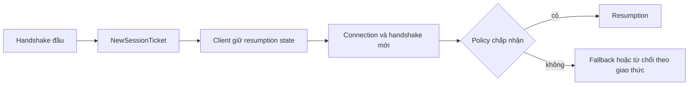

# TLS resumption: state, ticket và policy hiện hành

Trong TLS 1.3, NewSessionTicket cung cấp dữ liệu cho resumption dựa trên PSK; connection sau thực hiện handshake resumption và early data có yêu cầu chống replay riêng.

## Mục tiêu đo được

- So sánh lifetime của connection với resumption state.
- Giải thích vì sao dùng lại phiên không được coi là tái dùng mọi quyền cũ.

Kiến thức tiên quyết: [[PROTOCOL-TLS|TLS 1.3: handshake, identity và protected records]].

## Session không đồng nhất connection

Connection mới có thể dùng state từ một lần trao đổi trước để thiết lập khóa qua PSK resumption. RFC 8446 §2.2 và §4.6.1 mô tả vé và handshake tiếp theo. [[CLAIM-7EBD5B4A979DE0E75612046B|nhận định nguồn: CLAIM:7EBD5B4A979DE0E75612046B]] NewSessionTicket là message sau handshake, còn ticket là dữ liệu opaque cho client; server có thể dùng nó làm khóa tra cứu hoặc dữ liệu được bảo vệ tự chứa context. Không mặc định mọi ticket có cùng cấu trúc nội bộ.

_Diễn giải biên soạn; source support PARTIAL, AI self-review_: [[CLAIM-1945CB2CD633DBCEFE235982|Claim theo section]].

## Chu trình và trách nhiệm

Kết nối đầu thiết lập state → server cấp ticket → client giữ trong giới hạn cho phép → kết nối sau đề xuất resumption → server quyết định chấp nhận hay từ chối theo context → key schedule của handshake mới. Ticket lifetime, rotation và policy server làm giới hạn sử dụng; một ticket tồn tại không buộc server phải tiếp tục chấp nhận nó. Resumption cũng không có nghĩa socket cũ sống mãi.

Trong NGINX, tham chiếu bổ sung là các directive `ssl_session_cache`, `ssl_session_tickets`, `ssl_session_timeout` trong module SSL. Chúng mô tả lưu trữ và thời hạn, nhưng hiệu lực còn phụ thuộc phiên bản TLS và thư viện. Không đồng nhất cache truyền thống với mọi dạng resumption TLS 1.3.

_Diễn giải biên soạn; source support PARTIAL, AI self-review_: [[CLAIM-DBA66A3D0F79BE082B7DF7E3|Claim theo section]].

## Invariant phòng vệ — diễn giải có phạm vi

Policy dùng để chấp nhận identity/context của phiên phải phù hợp server đang xử lý. Việc chứng minh một secret hay có một ticket không tự chứng minh mọi quyền ở virtual server khác. Đây là nguyên tắc reasoning cho case advisory, chưa phải phân tích dòng mã hoặc xác nhận nguyên nhân CVE. Nguồn RFC và directive là nền; kết luận CVE phải đọc nguồn riêng.

_Diễn giải biên soạn; source support PARTIAL, AI self-review_: [[CLAIM-660665F8DA6E17CB7B38C640|Claim theo section]].

## Early data và tradeoff

Resumption giúp giảm công việc handshake. 0-RTT còn giảm chờ trước khi gửi dữ liệu nhưng có vấn đề replay được RFC §8 xử lý riêng. Không suy ra 'đã mã hóa' thành 'chỉ xử lý một lần'. Ứng dụng cần xem tính chất thao tác trước khi cho phép early data; bài này không bật cấu hình hoặc tạo traffic kiểm thử.

Ví dụ giấy: đánh dấu ticket được cấp tại T1, policy thay đổi ở T2, connection mới ở T3. Liệt kê bằng chứng cần có để kết luận state ở T1 còn được chấp nhận đúng tại T3. Không có policy/version thì kết luận UNKNOWN. Câu hỏi mở gồm invalidation khi đổi cấu hình, đặc tính thư viện TLS và phạm vi shared cache thực tế.

_Diễn giải biên soạn; source support PARTIAL, AI self-review_: [[CLAIM-646B78F60A69821F9008AAA1|Claim theo section]].

## Sơ đồ cơ chế

Sơ đồ là diễn giải sư phạm trong phạm vi bài; không phải sơ đồ mã nguồn đầy đủ.

## Tự đánh giá

1. Connection cũ đóng có bắt buộc mọi resumption state biến mất không?
2. Vì sao encrypted 0-RTT không đủ chứng minh một giao dịch chỉ xử lý một lần?

## Đáp án và giải thích

1. Không; state/ticket có lifetime khác connection, theo RFC §2.2/§4.6.1 ([[CLAIM-7EBD5B4A979DE0E75612046B|nhận định nguồn: CLAIM:7EBD5B4A979DE0E75612046B]]).
2. Replay là thuộc tính riêng của early data; RFC §8 yêu cầu reasoning ở mức server/application. Không được suy từ confidentiality ra at-most-once. Mỗi câu 0–2 điểm.

## Liên hệ và bước tiếp theo

[[PROTOCOL-TLS|TLS 1.3: handshake, identity và protected records]], [[WEAKNESS-CWE-863|Incorrect Authorization]], [[LEARNING-PATH-01|NGINX Architecture, TLS Security & Patch Verification]]

## Quan hệ có định kiểu

- `PARTICIPATES_IN` → [[PROTOCOL-TLS|TLS 1.3: handshake, identity và protected records]] — Resumption là cơ chế TLS theo RFC 8446; không kết luận fault location. **INTERPRETATION / NOT_REVIEWED**.
- `CONTEXTUAL_ASSOCIATION` → [[WEAKNESS-CWE-863|Incorrect Authorization]] — Policy context ở 23419 là ví dụ học về identity/authorization, không gộp hai thuật ngữ. Kiến trúc cung cấp context học lớp lỗi; không xác nhận mọi instance có lỗi. **INTERPRETATION / PARTIAL**.
- `REQUIRES_KNOWLEDGE_OF` → [[PROTOCOL-TLS|TLS 1.3: handshake, identity và protected records]] — Cần TLS 1.3: handshake, identity và protected records để giải thích mục tiêu: So sánh lifetime của connection với resumption state. **PEDAGOGICAL / NOT_REVIEWED**.
- `PRECEDES` → [[WEAKNESS-CWE-863|Incorrect Authorization]] — Thứ tự pilot chuyển từ cơ chế vừa học sang mục tiêu kế tiếp; là quyết định sư phạm, chưa learner-tested. **PEDAGOGICAL / NOT_REVIEWED**.
- `ASSESSED_BY` → [[LEARNING-PATH-01|NGINX Architecture, TLS Security & Patch Verification]] — Capstone yêu cầu vận dụng cơ chế này; đáp án và rubric nằm trong learning path. **PEDAGOGICAL / NOT_REVIEWED**.

## Truy vết nhận định

Mỗi link mở đúng Claim ID và giá trị; nhãn legacy không phải semantic approval.

| Claim / giá trị | Authority | Hiệu lực | Source support / review | Evidence locator |
| --- | --- | --- | --- | --- |
| [[CLAIM-7EBD5B4A979DE0E75612046B\|COMPONENT:TLS-SESSION-LIFECYCLE: pilot_source_statement]] — "Trong TLS 1.3, NewSessionTicket cung cấp dữ liệu cho resumption dựa trên PSK; connection sau thực hiện handshake resumption và early data có yêu cầu chống replay riêng." | IETF / RFC Editor | CURRENT | SUPPORTED / AI_REVIEWED | #section-2.2; #section-4.6.1; #section-8 — [[EVIDENCE-9BCA2F54CE3AA01B30718FD6\|tls13: #section-2.2; #section-4.6.1; #section-8]] |
| [[CLAIM-1945CB2CD633DBCEFE235982\|COMPONENT:TLS-SESSION-LIFECYCLE: pilot_section:Session không đồng nhất connection]] — "## Session không đồng nhất connection\n\nConnection mới có thể dùng state từ một lần trao đổi trước để thiết lập khóa qua PSK resumption. RFC 8446 §2.2 và §4.6.1 mô tả vé và hands… (mở Claim để đọc đủ) | NVKB AI curation | CURRENT | PARTIAL / AI_REVIEWED | #section-2.2; #section-4.6.1; #section-8 — [[EVIDENCE-9BCA2F54CE3AA01B30718FD6\|tls13: #section-2.2; #section-4.6.1; #section-8]] |
| [[CLAIM-DBA66A3D0F79BE082B7DF7E3\|COMPONENT:TLS-SESSION-LIFECYCLE: pilot_section:Chu trình và trách nhiệm]] — "## Chu trình và trách nhiệm\n\nKết nối đầu thiết lập state → server cấp ticket → client giữ trong giới hạn cho phép → kết nối sau đề xuất resumption → server quyết định chấp nhận … (mở Claim để đọc đủ) | NVKB AI curation | CURRENT | PARTIAL / AI_REVIEWED | #section-2.2; #section-4.6.1; #section-8 — [[EVIDENCE-9BCA2F54CE3AA01B30718FD6\|tls13: #section-2.2; #section-4.6.1; #section-8]] |
| [[CLAIM-660665F8DA6E17CB7B38C640\|COMPONENT:TLS-SESSION-LIFECYCLE: pilot_section:Invariant phòng vệ — diễn giải có phạm vi]] — "## Invariant phòng vệ — diễn giải có phạm vi\n\nPolicy dùng để chấp nhận identity/context của phiên phải phù hợp server đang xử lý. Việc chứng minh một secret hay có một ticket kh… (mở Claim để đọc đủ) | NVKB AI curation | CURRENT | PARTIAL / AI_REVIEWED | #section-2.2; #section-4.6.1; #section-8 — [[EVIDENCE-9BCA2F54CE3AA01B30718FD6\|tls13: #section-2.2; #section-4.6.1; #section-8]] |
| [[CLAIM-646B78F60A69821F9008AAA1\|COMPONENT:TLS-SESSION-LIFECYCLE: pilot_section:Early data và tradeoff]] — "## Early data và tradeoff\n\nResumption giúp giảm công việc handshake. 0-RTT còn giảm chờ trước khi gửi dữ liệu nhưng có vấn đề replay được RFC §8 xử lý riêng. Không suy ra 'đã mã… (mở Claim để đọc đủ) | NVKB AI curation | CURRENT | PARTIAL / AI_REVIEWED | #section-2.2; #section-4.6.1; #section-8 — [[EVIDENCE-9BCA2F54CE3AA01B30718FD6\|tls13: #section-2.2; #section-4.6.1; #section-8]] |

## Phạm vi kiểm chứng

[[EVIDENCE-9BCA2F54CE3AA01B30718FD6|tls13: #section-2.2; #section-4.6.1; #section-8]]

AI self-review of a scoped source statement and authored interpretations; human technical/pedagogical review and learner evaluation PENDING.

No deployment inspection or source-code root cause verification. Statements beyond cited mechanism are interpretations.

[[Learning-Library|Learning Library]] · [[Research-Library|Research Library]]

