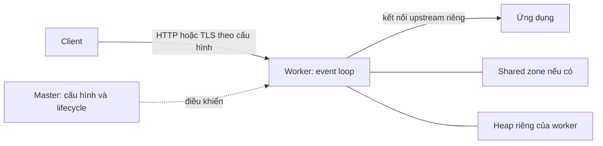

# Kiến trúc NGINX: tiến trình, kết nối và ranh giới tin cậy

Trong mô hình đa tiến trình, master điều phối cấu hình và các tiến trình con; worker xử lý kết nối client.

## Mục tiêu đo được

- Vẽ đường đi request qua worker và upstream, phân biệt với đường điều khiển của master.
- Chỉ ra ba nơi cần kiểm chứng identity hoặc policy trong một reverse proxy được quản trị.

## Mô hình hệ thống và phạm vi

NGINX reverse proxy tiếp nhận HTTP từ client và tạo trao đổi riêng với upstream. Trong mô hình đa tiến trình thông thường, đường điều khiển của master khác đường xử lý lưu lượng của worker. [[CLAIM-707C7FEECCD5DA9B16C00F49|nhận định nguồn: CLAIM:707C7FEECCD5DA9B16C00F49]] Mô hình này không có nghĩa master chuyển từng request cho worker: worker có event loop và các connection riêng. Cache manager/loader có trách nhiệm phụ trợ nếu tính năng tương ứng được dùng; cấu hình single-process là ngoại lệ được development guide mô tả.

_Diễn giải biên soạn; source support PARTIAL, AI self-review_: [[CLAIM-09D1B7D1254633EA0912593B|Claim theo section]].

## Cơ chế và ownership

Một client connection và một upstream connection là hai đối tượng có thời hạn, timeout và lỗi riêng. Worker tiếp nhận dữ liệu, chọn cấu hình HTTP, thực hiện các phase, rồi gửi nội dung ra socket; khi proxy, upstream có thể được tái sử dụng theo cấu hình. Request không sở hữu toàn bộ thế giới bên ngoài nó. Những tài nguyên được chia sẻ giữa worker phải có cơ chế shared memory riêng; một biến trong heap worker không tự trở thành trạng thái chung.

_Diễn giải biên soạn; source support PARTIAL, AI self-review_: [[CLAIM-18D76E6F6595D97C49E03B06|Claim theo section]].

## Security boundary không phải hộp trên sơ đồ

Phần này là suy luận phòng vệ từ cấu trúc trên. Ranh giới client → proxy cần quyết định dữ liệu nào được tin; proxy → upstream cần xác định danh tính đích và chính sách truyền metadata. Master → worker là quan hệ quản lý tiến trình, chưa tự chứng minh mỗi virtual host bị cô lập như một container. TLS kết thúc tại proxy cũng không tự làm đoạn upstream được mã hóa. Những điều này phải được kiểm tra từ cấu hình triển khai, không suy ra từ vị trí trong sơ đồ.

Invariant thiết kế: chỉ dùng một thuộc tính identity để quyết định quyền nếu nguồn sinh thuộc tính đó và nơi kiểm tra nó đã được xác định. Đổi tên header không tạo ra nguồn tin cậy. Một bản vẽ tốt ghi cả ai tạo state, ai dùng state và ai hủy state.

_Diễn giải biên soạn; source support PARTIAL, AI self-review_: [[CLAIM-55DD3F817F5A0AFD2BD32A94|Claim theo section]].

## Tradeoff và ví dụ phòng vệ

Mô hình nhiều worker tận dụng nhiều CPU; shared cache cải thiện tái sử dụng nhưng thêm state có scope khác heap cục bộ. Buffering có thể giảm phụ thuộc tốc độ giữa hai đầu, đổi lại chi phí bộ nhớ/đĩa và latency. Đây là lựa chọn thiết kế, không bảo đảm throughput trong mọi workload.

Bài tập giấy: với sơ đồ client → proxy → ứng dụng, đánh dấu nơi TLS kết thúc và nơi ứng dụng kiểm tra quyền đọc tài liệu. Nếu chưa có cấu hình upstream, ghi UNKNOWN cho bảo vệ đoạn đó. Không tạo traffic hoặc dùng địa chỉ hệ thống thật.

_Diễn giải biên soạn; source support PARTIAL, AI self-review_: [[CLAIM-92CB6FA3C918C8A2BEC4A016|Claim theo section]].

## Ngộ nhận và câu hỏi mở

Một worker không phải một virtual host. Có TLS không đồng nghĩa đã cấp quyền đúng. Chưa có inventory, build flags hoặc cấu hình thật để xác nhận các ranh giới trong một deployment cụ thể. Nguồn: development guide theo snapshot, không cam kết mọi module bên thứ ba.

_Diễn giải biên soạn; source support PARTIAL, AI self-review_: [[CLAIM-BBD6C877F9D37C6D536B6600|Claim theo section]].

## Sơ đồ cơ chế

Sơ đồ là diễn giải sư phạm trong phạm vi bài; không phải sơ đồ mã nguồn đầy đủ.

## Tự đánh giá

1. Master có cần xử lý từng request để điều phối worker không? Giải thích đường điều khiển.
2. Một sơ đồ có hai hộp proxy/app và biểu tượng khóa phía client đã chứng minh TLS phía upstream chưa?

## Đáp án và giải thích

1. Không trong mô hình đa tiến trình: worker xử lý kết nối; master điều phối lifecycle ([[CLAIM-707C7FEECCD5DA9B16C00F49|nhận định nguồn: CLAIM:707C7FEECCD5DA9B16C00F49]]).
2. Chưa. Khóa phía client chỉ mô tả một đoạn. Cần cấu hình và bằng chứng TLS của kết nối upstream; đáp án UNKNOWN là đúng khi thiếu dữ liệu. Mỗi câu 0–2 điểm: kết luận và lý do tách biệt.

## Liên hệ và bước tiếp theo

[[COMPONENT-MASTER-PROCESS|Master, worker và graceful reload]], [[LEARNING-PATH-01|NGINX Architecture, TLS Security & Patch Verification]]

## Quan hệ có định kiểu

- `learns_from` → [[COMPONENT-REVERSE-PROXY|Reverse proxy]] — Kiến trúc NGINX: tiến trình, kết nối và ranh giới tin cậy sử dụng Reverse proxy như kiến thức nền. Mục tiêu nền của bài đích: Thành phần nhận request client và chuyển tới upstream rồi trả response. Đây là quyết định sư phạm; không chứng minh prerequisite bắt buộc hoặc kết quả học tập. Các path ngoài pilot chưa được nâng lên curriculum đã thẩm định. **PEDAGOGICAL / PARTIAL**.
- `learns_from` → [[COMPONENT-UPSTREAM-COMMUNICATION|Upstream communication — hai hop và ownership của response]] — Kiến trúc NGINX: tiến trình, kết nối và ranh giới tin cậy sử dụng Upstream communication — hai hop và ownership của response như kiến thức nền. Mục tiêu nền của bài đích: Proxy module quản lý request/response tới upstream, chế độ buffering và TLS verification riêng; connection tới client và upstream là hai context khác nhau. Đây là quyết định sư phạm; không chứng minh prerequisite bắt buộc hoặc kết quả học tập. Các path ngoài pilot chưa được nâng lên curriculum đã thẩm định. **PEDAGOGICAL / PARTIAL**.
- `learns_from` → [[PROTOCOL-TLS|TLS 1.3: handshake, identity và protected records]] — Kiến trúc NGINX: tiến trình, kết nối và ranh giới tin cậy sử dụng TLS 1.3: handshake, identity và protected records như kiến thức nền. Mục tiêu nền của bài đích: TLS 1.3 kết hợp handshake thiết lập khóa và xác thực với record protection; certificate authentication và PSK là các cơ chế khác nhau được RFC mô tả. Đây là quyết định sư phạm; không chứng minh prerequisite bắt buộc hoặc kết quả học tập. Các path ngoài pilot chưa được nâng lên curriculum đã thẩm định. **PEDAGOGICAL / PARTIAL**.
- `PRECEDES` → [[COMPONENT-MASTER-PROCESS|Master, worker và graceful reload]] — Thứ tự pilot chuyển từ cơ chế vừa học sang mục tiêu kế tiếp; là quyết định sư phạm, chưa learner-tested. **PEDAGOGICAL / NOT_REVIEWED**.
- `ASSESSED_BY` → [[LEARNING-PATH-01|NGINX Architecture, TLS Security & Patch Verification]] — Capstone yêu cầu vận dụng cơ chế này; đáp án và rubric nằm trong learning path. **PEDAGOGICAL / NOT_REVIEWED**.

## Truy vết nhận định

Mỗi link mở đúng Claim ID và giá trị; nhãn legacy không phải semantic approval.

| Claim / giá trị | Authority | Hiệu lực | Source support / review | Evidence locator |
| --- | --- | --- | --- | --- |
| [[CLAIM-707C7FEECCD5DA9B16C00F49\|DEPLOYMENT:REVERSE-PROXY: pilot_source_statement]] — "Trong mô hình đa tiến trình, master điều phối cấu hình và các tiến trình con; worker xử lý kết nối client." | NGINX / F5 | CURRENT | SUPPORTED / AI_REVIEWED | #processes; #http; #connection — [[EVIDENCE-33D805BB8AC5FA2631CDD0EA\|development: #processes; #http; #connection]] |
| [[CLAIM-09D1B7D1254633EA0912593B\|DEPLOYMENT:REVERSE-PROXY: pilot_section:Mô hình hệ thống và phạm vi]] — "## Mô hình hệ thống và phạm vi\n\nNGINX reverse proxy tiếp nhận HTTP từ client và tạo trao đổi riêng với upstream. Trong mô hình đa tiến trình thông thường, đường điều khiển của m… (mở Claim để đọc đủ) | NVKB AI curation | CURRENT | PARTIAL / AI_REVIEWED | #processes; #http; #connection — [[EVIDENCE-33D805BB8AC5FA2631CDD0EA\|development: #processes; #http; #connection]] |
| [[CLAIM-18D76E6F6595D97C49E03B06\|DEPLOYMENT:REVERSE-PROXY: pilot_section:Cơ chế và ownership]] — "## Cơ chế và ownership\n\nMột client connection và một upstream connection là hai đối tượng có thời hạn, timeout và lỗi riêng. Worker tiếp nhận dữ liệu, chọn cấu hình HTTP, thực h… (mở Claim để đọc đủ) | NVKB AI curation | CURRENT | PARTIAL / AI_REVIEWED | #processes; #http; #connection — [[EVIDENCE-33D805BB8AC5FA2631CDD0EA\|development: #processes; #http; #connection]] |
| [[CLAIM-55DD3F817F5A0AFD2BD32A94\|DEPLOYMENT:REVERSE-PROXY: pilot_section:Security boundary không phải hộp trên sơ đồ]] — "## Security boundary không phải hộp trên sơ đồ\n\nPhần này là suy luận phòng vệ từ cấu trúc trên. Ranh giới client → proxy cần quyết định dữ liệu nào được tin; proxy → upstream cầ… (mở Claim để đọc đủ) | NVKB AI curation | CURRENT | PARTIAL / AI_REVIEWED | #processes; #http; #connection — [[EVIDENCE-33D805BB8AC5FA2631CDD0EA\|development: #processes; #http; #connection]] |
| [[CLAIM-92CB6FA3C918C8A2BEC4A016\|DEPLOYMENT:REVERSE-PROXY: pilot_section:Tradeoff và ví dụ phòng vệ]] — "## Tradeoff và ví dụ phòng vệ\n\nMô hình nhiều worker tận dụng nhiều CPU; shared cache cải thiện tái sử dụng nhưng thêm state có scope khác heap cục bộ. Buffering có thể giảm phụ … (mở Claim để đọc đủ) | NVKB AI curation | CURRENT | PARTIAL / AI_REVIEWED | #processes; #http; #connection — [[EVIDENCE-33D805BB8AC5FA2631CDD0EA\|development: #processes; #http; #connection]] |
| [[CLAIM-BBD6C877F9D37C6D536B6600\|DEPLOYMENT:REVERSE-PROXY: pilot_section:Ngộ nhận và câu hỏi mở]] — "## Ngộ nhận và câu hỏi mở\n\nMột worker không phải một virtual host. Có TLS không đồng nghĩa đã cấp quyền đúng. Chưa có inventory, build flags hoặc cấu hình thật để xác nhận các r… (mở Claim để đọc đủ) | NVKB AI curation | CURRENT | PARTIAL / AI_REVIEWED | #processes; #http; #connection — [[EVIDENCE-33D805BB8AC5FA2631CDD0EA\|development: #processes; #http; #connection]] |

## Phạm vi kiểm chứng

[[EVIDENCE-33D805BB8AC5FA2631CDD0EA|development: #processes; #http; #connection]]

AI self-review of a scoped source statement and authored interpretations; human technical/pedagogical review and learner evaluation PENDING.

No deployment inspection or source-code root cause verification. Statements beyond cited mechanism are interpretations.

[[Learning-Library|Learning Library]] · [[Research-Library|Research Library]]

