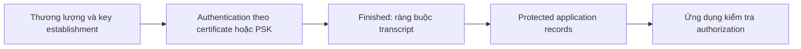

# TLS 1.3: handshake, identity và protected records

TLS 1.3 kết hợp handshake thiết lập khóa và xác thực với record protection; certificate authentication và PSK là các cơ chế khác nhau được RFC mô tả.

## Mục tiêu đo được

- Phân biệt key establishment, peer authentication và application authorization.
- Giải thích vai trò transcript và Finished trong handshake ở mức nguyên lý.

Kiến thức tiên quyết: [[COMPONENT-CONNECTION-LIFECYCLE|Connection và HTTP request: hai vòng đời]].

## Phạm vi chuẩn

Bài này theo RFC 8446 cho TLS 1.3; không dùng hình handshake này để mô tả chính xác TLS 1.2. Handshake thương lượng tham số, thiết lập key material và xác thực theo cơ chế được chọn. Record layer bảo vệ dữ liệu với các khóa tương ứng. Các section 2, 4.4 và 5 là phạm vi nguồn của [[CLAIM-CB48F48319CC5E07D78E5B02|nhận định nguồn: CLAIM:CB48F48319CC5E07D78E5B02]].

_Diễn giải biên soạn; source support PARTIAL, AI self-review_: [[CLAIM-1D23F85B9ACB1C530EDB5C6F|Claim theo section]].

## Cơ chế và trạng thái

Với certificate authentication, chứng thư mang thông tin khóa/danh tính còn CertificateVerify chứng minh quyền dùng khóa ký trong context handshake. Finished ràng buộc transcript bằng key material đã dẫn xuất. Kiểm chứng không chỉ là nhìn thấy một certificate: peer phải thực hiện kiểm tra chain, tên đích và policy liên quan trong phạm vi vai trò của nó. Handshake hoàn tất và ứng dụng cấp quyền là hai quyết định khác nhau.

Một connection có các giai đoạn key schedule và traffic secrets; không nên coi một khóa duy nhất được dùng bất biến cho mọi hướng và mọi giai đoạn. RFC xác định các message và chuyển tiếp hợp lệ; sơ đồ rút gọn của bài chỉ hỗ trợ phân biệt handshake với dữ liệu ứng dụng, không mô tả mọi nhánh optional.

_Diễn giải biên soạn; source support PARTIAL, AI self-review_: [[CLAIM-A38111687117112E2D2BA9AD|Claim theo section]].

## Ownership và security reasoning

TLS endpoint sở hữu secret và context handshake. Nếu proxy kết thúc TLS, ứng dụng phía sau cần quy ước rõ về metadata identity do proxy chuyển tiếp. Diễn giải invariant: một bằng chứng xác thực phải được dùng đúng peer, đúng transcript/context và đúng policy. Authorization nghiệp vụ vẫn phải kiểm tra hành động trên tài nguyên dù kênh TLS đã xác thực.

_Diễn giải biên soạn; source support PARTIAL, AI self-review_: [[CLAIM-5C1426EF43ABF024C3E0524B|Claim theo section]].

## Tradeoff và giới hạn phòng vệ

Resumption giảm chi phí handshake nhưng thêm state và policy về tái sử dụng. Early data có giới hạn replay riêng, không được coi như dữ liệu sau full handshake trong mọi ứng dụng. Hỗ trợ giao thức của NGINX còn phụ thuộc build và thư viện TLS; RFC là chuẩn giao thức, không chứng minh compile flags của binary đang chạy.

Ví dụ: chứng thư client hợp lệ cho tài khoản A không đủ chứng minh A được sửa tài liệu của B. Xác định kiểm tra nào thuộc TLS và kiểm tra nào thuộc ứng dụng. Câu hỏi mở: trust store, revocation policy và tên peer được xác minh ở thành phần nào trong deployment?

_Diễn giải biên soạn; source support PARTIAL, AI self-review_: [[CLAIM-42CA9CD3EDDAE8437190E3A3|Claim theo section]].

## Sơ đồ cơ chế

Sơ đồ là diễn giải sư phạm trong phạm vi bài; không phải sơ đồ mã nguồn đầy đủ.

## Tự đánh giá

1. CertificateVerify và một certificate được gửi đến có cùng chức năng không?
2. TLS client authentication có thay thế kiểm tra quyền sửa dữ liệu không?

## Đáp án và giải thích

1. Không: certificate mang thông tin identity/key; CertificateVerify chứng minh sử dụng khóa ký gắn transcript. Xem RFC §4.4.2–4.4.3 trong [[CLAIM-CB48F48319CC5E07D78E5B02|nhận định nguồn: CLAIM:CB48F48319CC5E07D78E5B02]].
2. Không: xác thực peer không quyết định quyền trên tài nguyên ứng dụng. 2 điểm mỗi câu, trừ một điểm nếu nhầm authentication với encryption.

## Liên hệ và bước tiếp theo

[[COMPONENT-CONNECTION-LIFECYCLE|Connection và HTTP request: hai vòng đời]], [[COMPONENT-TLS-SESSION-LIFECYCLE|TLS resumption: state, ticket và policy hiện hành]], [[LEARNING-PATH-01|NGINX Architecture, TLS Security & Patch Verification]]

## Quan hệ có định kiểu

- `ASSESSED_BY` → [[LEARNING-PATH-01|NGINX Architecture, TLS Security & Patch Verification]] — Capstone yêu cầu vận dụng cơ chế này; đáp án và rubric nằm trong learning path. **PEDAGOGICAL / NOT_REVIEWED**.
- `CONTEXTUAL_ASSOCIATION` → [[WEAKNESS-CWE-863|Incorrect Authorization]] — TLS authentication và authorization có quan hệ context nhưng không đồng nghĩa. **INTERPRETATION / NOT_REVIEWED**.
- `PRECEDES` → [[COMPONENT-TLS-SESSION-LIFECYCLE|TLS resumption: state, ticket và policy hiện hành]] — Thứ tự pilot chuyển từ cơ chế vừa học sang mục tiêu kế tiếp; là quyết định sư phạm, chưa learner-tested. **PEDAGOGICAL / NOT_REVIEWED**.
- `REQUIRES_KNOWLEDGE_OF` → [[COMPONENT-CONNECTION-LIFECYCLE|Connection và HTTP request: hai vòng đời]] — Cần Connection và HTTP request: hai vòng đời để giải thích mục tiêu: Phân biệt key establishment, peer authentication và application authorization. **PEDAGOGICAL / NOT_REVIEWED**.

## Truy vết nhận định

Mỗi link mở đúng Claim ID và giá trị; nhãn legacy không phải semantic approval.

| Claim / giá trị | Authority | Hiệu lực | Source support / review | Evidence locator |
| --- | --- | --- | --- | --- |
| [[CLAIM-CB48F48319CC5E07D78E5B02\|PROTOCOL:TLS: pilot_source_statement]] — "TLS 1.3 kết hợp handshake thiết lập khóa và xác thực với record protection; certificate authentication và PSK là các cơ chế khác nhau được RFC mô tả." | IETF / RFC Editor | CURRENT | SUPPORTED / AI_REVIEWED | #section-2; #section-4.4; #section-5 — [[EVIDENCE-D520284776E11B5BE3AC5151\|tls13: #section-2; #section-4.4; #section-5]] |
| [[CLAIM-1D23F85B9ACB1C530EDB5C6F\|PROTOCOL:TLS: pilot_section:Phạm vi chuẩn]] — "## Phạm vi chuẩn\n\nBài này theo RFC 8446 cho TLS 1.3; không dùng hình handshake này để mô tả chính xác TLS 1.2. Handshake thương lượng tham số, thiết lập key material và xác thực… (mở Claim để đọc đủ) | NVKB AI curation | CURRENT | PARTIAL / AI_REVIEWED | #section-2; #section-4.4; #section-5 — [[EVIDENCE-D520284776E11B5BE3AC5151\|tls13: #section-2; #section-4.4; #section-5]] |
| [[CLAIM-A38111687117112E2D2BA9AD\|PROTOCOL:TLS: pilot_section:Cơ chế và trạng thái]] — "## Cơ chế và trạng thái\n\nVới certificate authentication, chứng thư mang thông tin khóa/danh tính còn CertificateVerify chứng minh quyền dùng khóa ký trong context handshake. Fin… (mở Claim để đọc đủ) | NVKB AI curation | CURRENT | PARTIAL / AI_REVIEWED | #section-2; #section-4.4; #section-5 — [[EVIDENCE-D520284776E11B5BE3AC5151\|tls13: #section-2; #section-4.4; #section-5]] |
| [[CLAIM-5C1426EF43ABF024C3E0524B\|PROTOCOL:TLS: pilot_section:Ownership và security reasoning]] — "## Ownership và security reasoning\n\nTLS endpoint sở hữu secret và context handshake. Nếu proxy kết thúc TLS, ứng dụng phía sau cần quy ước rõ về metadata identity do proxy chuyể… (mở Claim để đọc đủ) | NVKB AI curation | CURRENT | PARTIAL / AI_REVIEWED | #section-2; #section-4.4; #section-5 — [[EVIDENCE-D520284776E11B5BE3AC5151\|tls13: #section-2; #section-4.4; #section-5]] |
| [[CLAIM-42CA9CD3EDDAE8437190E3A3\|PROTOCOL:TLS: pilot_section:Tradeoff và giới hạn phòng vệ]] — "## Tradeoff và giới hạn phòng vệ\n\nResumption giảm chi phí handshake nhưng thêm state và policy về tái sử dụng. Early data có giới hạn replay riêng, không được coi như dữ liệu sa… (mở Claim để đọc đủ) | NVKB AI curation | CURRENT | PARTIAL / AI_REVIEWED | #section-2; #section-4.4; #section-5 — [[EVIDENCE-D520284776E11B5BE3AC5151\|tls13: #section-2; #section-4.4; #section-5]] |

## Phạm vi kiểm chứng

[[EVIDENCE-D520284776E11B5BE3AC5151|tls13: #section-2; #section-4.4; #section-5]]

AI self-review of a scoped source statement and authored interpretations; human technical/pedagogical review and learner evaluation PENDING.

No deployment inspection or source-code root cause verification. Statements beyond cited mechanism are interpretations.

[[Learning-Library|Learning Library]] · [[Research-Library|Research Library]]

